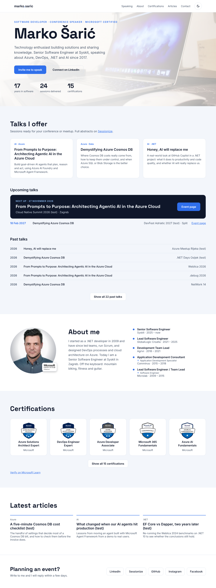
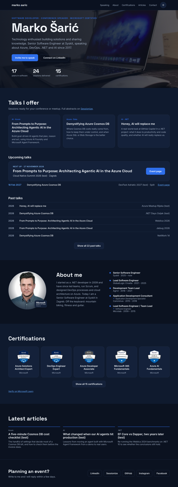
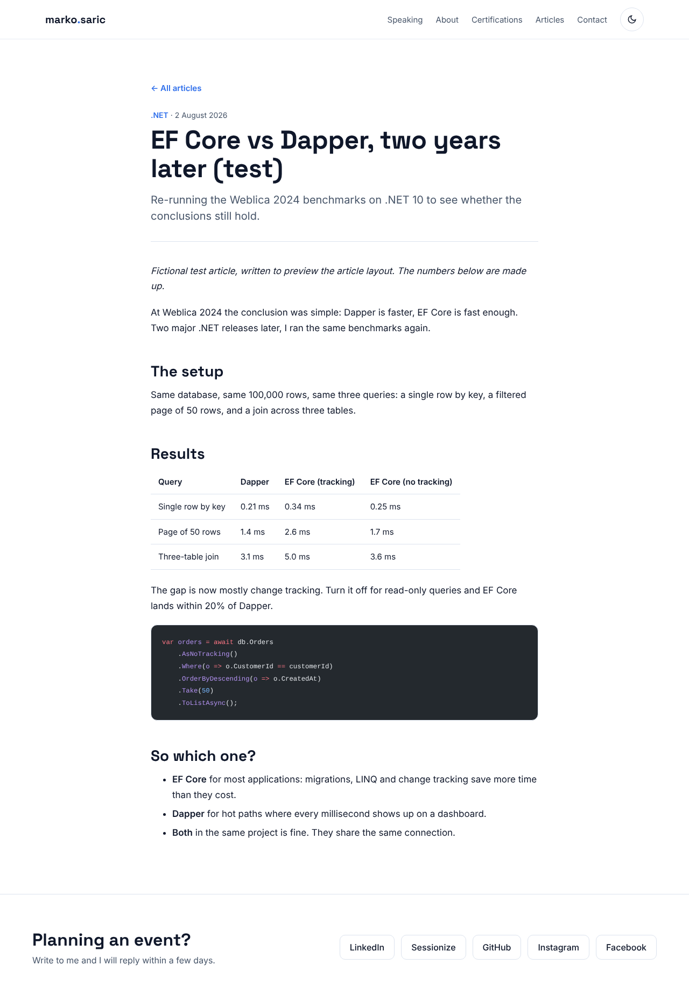
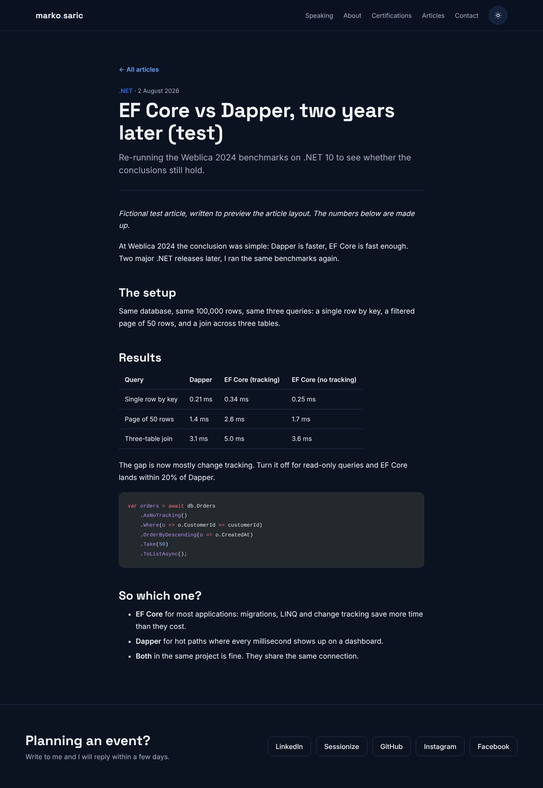

# personalweb

Marko Šarić's personal website: an [Astro](https://astro.build) static site built from the approved Keynote design in [`docs/design/`](docs/design/).

## Preview

Homepage as built from this code (1280 px wide), light and dark. The screenshots use fictional test content (upcoming talks, three extra past talks and three articles, all marked "(test)") so every section shows, including "Upcoming talks" and "Latest articles". None of that test content is in the repo.

| Light | Dark |
| --- | --- |
|  |  |

An article page:

| Light | Dark |
| --- | --- |
|  |  |

On a phone (390 px):

<p>
  
  
</p>

The design these screenshots come from is in [`docs/design/`](docs/design/) (`keynote.dc.html`), with the live version on the Personal Landing Page Design canvas.

To refresh the screenshots, add some test talks and articles, run `npm run build && npm run preview`, and capture `http://localhost:4321` and one article page at 1280 px (full page) and the homepage at 390 px, in both colour schemes.

## Run it

```sh
npm install
npm run dev      # http://localhost:4321
npm run build    # type-checks, then builds to dist/
npm run preview  # serves dist/
```

## Where the content lives

| What | File |
| --- | --- |
| Name, headline, tagline, bio, profile links, socials | `src/data/profile.ts` |
| Talks I offer (Markdown) | `src/content/talks/offers/*.md` |
| Upcoming talks (Markdown) | `src/content/talks/upcoming/*.md` |
| Past talks (Markdown) | `src/content/talks/past/*.md` |
| Experience timeline | `src/data/jobs.ts` |
| Certifications (order, badge images) | `src/data/certifications.ts` |
| Articles (Markdown) | `src/content/articles/*.md` |
| Images | `src/assets/` (optimised to WebP at build time) |

The hero numbers are computed at build time: years in software from 2009, sessions delivered from the past-talks list (a row covering several events sets `sessions`), and certifications from the certifications list.

### Adding a talk

Create `src/content/talks/past/<year>-<event>.md`:

```md
---
title: Talk title
event: Weblica 2027
year: 2027
slides: https://...   # optional
video: https://...    # optional
---
```

Talks sort by `year`, newest first. When a year has several talks, add `order` (higher shows first). An entry that covers several events sets `sessions` so the hero count stays right.

### Adding an upcoming talk

Create `src/content/talks/upcoming/<year>-<event>.md`:

```md
---
title: Talk title
event: Weblica 2027
date: 2027-05-14
city: Zagreb                 # optional
url: https://...             # optional, the event page
---
```

The soonest talk is featured as "Next up"; later ones are listed under it. The "Upcoming talks" block only shows while at least one talk is dated today or later. "Today" is the build date, so rebuild the site after a talk to move it along. Once a talk's date has passed it is listed under past talks automatically and counts toward sessions delivered. Move the file into `past/` (with `year` instead of `date`) whenever you want to add slides or video links.

### Adding a talk offer

Create `src/content/talks/offers/my-talk.md` with `title`, `tag`, `blurb` and `order` (card position, lowest first). Set `draft: true` to hide one without deleting it.

### Adding an article

Create `src/content/articles/my-article.md`:

```md
---
title: My article
summary: One or two sentences for the homepage card.
tag: Azure
date: 2026-11-05
---

Article body.
```

The "Latest articles" section and its menu link appear once there is at least one article. Each article gets its own page at `/articles/<file-name>/`, linked from its card. The body supports headings, lists, tables, quotes and code blocks.

## Theme

Light and dark follow the visitor's system setting until they use the toggle; the choice is saved in `localStorage`. Colours are CSS variables in `src/styles/global.css`.
